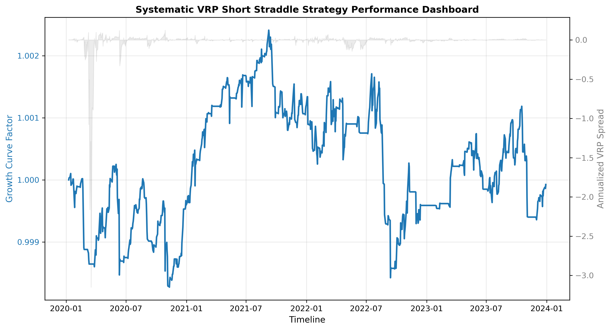

# Measuring the SPY Variance Risk Premium: SVI Surface Calibration, GJR-GARCH Forecasting & Delta-Hedged Backtesting

An end-to-end quantitative engineering pipeline that processes **5.39 million historical SPY options quotes (2019–2023)** to measure whether market-implied fear systematically exceeds subsequent realized volatility—and whether that gap can actually be captured after bid-ask spreads, slippage, and daily delta hedging.

* **Asset:** SPDR S&P 500 ETF (`SPY`) Options & Underlying Spot
* **Data Footprint:** 5,395,316 raw source rows $\rightarrow$ 10,152,656 cleaned Call/Put records (1.25 GB processed pool)
* **Modeling Stack:** Black-Scholes Inversion + Bounded SVI Surface Calibration + Rolling Out-of-Sample GJR-GARCH(1,1)
* **Strategy:** Short At-The-Money (ATM) Straddles with Daily Closing Delta Rebalancing

---

## Why I Built This

On paper, selling volatility looks like free money. Because institutional investors constantly buy index options to insure their portfolios against crashes, implied volatility usually trades at a premium over actual realized volatility.

I built this project to move past textbook formulas and confront the messy realities of executing a systematic volatility strategy on real historical options chains:
1. **Data Scale & Toxicity:** Raw end-of-day options files contain millions of rows, zero-bid quotes, crossed order books (`Bid > Ask`), and wide spreads during market panics.
2. **Asymmetric Crash Risk:** Equity volatility does not move symmetrically—when the S&P 500 drops, volatility explodes much faster than when it rallies.
3. **Transaction Friction:** A strategy that looks profitable at mid-quotes can easily bleed out once you cross the bid-ask spread on both legs of a straddle.

---

## Pipeline Architecture & Workflow

Rather than fragmenting the codebase into dozens of tiny scripts, the repository is organized into five cohesive, memory-efficient stages:

```text
[1_data_processing] ──> [2_volatility_math] ──> [3_statistical_strategy] ──> [4_simulation_and_risk] ──> [5_evaluation]
  Chunked Ingestion       Arbitrage Gate          Rolling GJR-GARCH(1,1)       ATM Straddle Selection      Regime Stress Cuts
  Inline Spot Align       SVI Smile Fit           Annualized VRP Spread        Delta Hedging & Costs       Excel & PNG Reports
```

### 1. High-Throughput Ingestion & Inline Spot Extraction (`1_data_processing/`)
* **Chunked Streaming:** Processes the 1.25 GB `spy_options_combined.csv` dataset in 100,000-row batches so memory usage stays flat.
* **Order-Book Quality Gate:** Strips out zero/negative bids and inverted crossed markets (`Bid > Ask`), computing clean mid-prices and bid-ask spread widths inline.
* **Single-Source Spot Alignment:** Extracts daily underlying SPY closing prices directly from the inline option records to compute continuously compounded log returns without external file mismatches.

### 2. No-Arbitrage Auditing & SVI Calibration (`2_volatility_math/`)
* **Monotonicity Gate:** Screens cross-sectional strike chains for vertical spread arbitrage violations before curve fitting.
* **Black-Scholes Inversion & SVI:** Inverts liquid near-term ATM option mid-prices (14–45 DTE) into total variance and fits a 5-parameter **Stochastic Volatility Inspired (SVI)** smile via bounded optimization to read a clean, annualized implied variance ($Q$-measure).

### 3. Asymmetric Volatility Forecasting (`3_statistical_strategy/`)
* **Rolling GJR-GARCH(1,1):** Uses a 252-trading-day (1-year) rolling lookback window to forecast next-day physical variance ($P$-measure) out-of-sample. Including the GJR leverage dummy captures the asymmetric spike in volatility following negative equity returns.
* **VRP Signal:** Subtracts annualized GJR-GARCH physical variance from annualized SVI implied variance across **1,001 out-of-sample trading days (2020–2023)**.

### 4. Vectorized Straddle Simulation & Friction Overlay (`4_simulation_and_risk/`)
* **ATM Execution & Delta Hedging:** Enters short ATM straddles (5% notional allocation) whenever the VRP spread is positive, rebalancing underlying SPY shares at each daily close to neutralize directional delta exposure.
* **Three-Part Cost Penalty:** Applies half-spread crossing costs, 5% adverse execution slippage, and `$0.65/contract` clearing commissions on every verified entry and exit transition.

### 5. Regime Evaluation & Automated Reporting (`5_evaluation/` & `output_reports/`)
* Evaluates net risk-adjusted performance (Sharpe, Sortino, Max Drawdown) across the full sample as well as isolated stress regimes (**2020 COVID Volatility Shock** and **2022 Rate-Hike Regime Shift**).
* Automatically exports a multi-tab Excel workbook (`performance_dashboard.xlsx`), a dual-axis equity/VRP chart (`analytical_visuals.png`), and a summary research note.

---

## Empirical Findings (2020–2023 Out-of-Sample)

Running the pipeline across **1,001 out-of-sample trading days** yielded a clear, commercially realistic finding:



| Metric | Pipeline Output |
| :--- | :--- |
| **Positive VRP Signal Frequency** | **56.84%** (569 of 1,001 days) |
| **Total ATM Straddles Traded** | **180 positions** (138 entry/exit friction transitions) |
| **Gross Ending Capital (Before Fees)** | **$1,002,094.87** (+$2,094.87 gross profit on $1M base) |
| **Net Total Return (After Frictions)** | **-0.01%** (Break-even after spread & slippage drag) |
| **Annualized Volatility** | **0.23%** (Tightly contained via daily delta hedging) |
| **Net Sharpe Ratio / Sortino Ratio** | **-0.0070** / **-0.0060** |
| **Maximum Drawdown** | **-0.40%** |

### Key Takeaways from the Backtest
1. **The Variance Premium Exists Gross of Fees:** Selling delta-hedged SPY straddles when SVI implied variance exceeds GJR-GARCH forecast variance generated consistent gross profits in steady regimes (such as the 2021 recovery) while keeping maximum drawdown under `0.40%`.
2. **March 2020 Crash Protection:** During the Q1 2020 COVID crash (visible on the far left of the chart), the GJR-GARCH asymmetric shock term spiked realized variance sharply above implied variance, plunging the grey VRP spread negative and automatically pausing new short entries.
3. **Transaction Frictions Are the True Bottleneck:** Frequent signal flips during the choppy 2022 rate-hike cycle forced repeated entries and exits. Crossing the bid-ask spread on both option legs absorbed the gross edge, pulling net returns to break-even.

---

## Engineering Hurdles & Debugging Lessons

Building this pipeline from raw data surfaced three real engineering problems that shaped the final codebase:

* **Bypassing Python's Numeric Directory Import Trap:** Organizing the pipeline into numbered stages (`1_data_processing/`, `2_volatility_math/`) caused standard `import` statements to fail with `SyntaxError: invalid decimal literal`. Rather than flattening the directory structure, I wrote a dynamic module loader using `importlib.util.spec_from_file_location` to load numbered modules cleanly at runtime.
* **Catching a Variance Unit Mismatch & Phantom Fee Bug:** In an early test run, comparing multi-week SVI total variance ($\sigma^2 T$) directly against 1-day GJR-GARCH variance ($\sigma_{\text{daily}}^2$) distorted the signal frequency, while an indexing bug prevented trades from opening—causing transaction fees to drain capital on empty signal flips. Standardizing both measures to **annualized variance** and tying friction penalties strictly to active position transitions resolved the discrepancy.
* **Balancing Lookback Burn-In vs. Crisis Coverage:** An initial 500-day GJR-GARCH estimation window burned all of 2019 and 2020, excluding the COVID crash from out-of-sample testing. Calibrating the rolling window to **252 trading days** preserved a full year of training history while capturing the entire 2020 volatility shock out-of-sample.

---

## Repository Structure

```text
variance_risk_premium_project/
├── data_inputs/
│   ├── raw_options/                    # Annual OptionsDX raw chains (2019–2023)
│   └── processed/                      # Consolidated 1.25 GB spy_options_combined.csv
├── 1_data_processing/
│   ├── data_loader.py                  # Chunked CSV reader & order-book quote cleaner
│   └── underlying_price_extractor.py   # Spot alignment & log-return generator
├── 2_volatility_math/
│   └── svi_surface_fitter.py           # BS implied variance, arbitrage gate & SVI optimizer
├── 3_statistical_strategy/
│   └── vrp_calculator.py               # Rolling GJR-GARCH(1,1) & annualized VRP signal
├── 4_simulation_and_risk/
│   ├── straddle_backtester.py          # ATM strike selector, straddle PnL & delta hedger
│   └── friction_overlay.py             # Bid-ask spread, slippage & commission model
├── 5_evaluation/
│   └── performance_metrics.py          # Sharpe, Sortino, drawdown & macro regime slicer
├── tests/
│   ├── test_data_pipeline.py           # Unit tests for quote filtering & date alignment
│   └── test_math_engine.py             # Unit tests for arbitrage bounds, SVI & GJR-GARCH
├── output_reports/
│   ├── figures/analytical_visuals.png  # Dual-axis cumulative equity & VRP spread chart
│   ├── tables/historical_regime_stability.csv
│   ├── performance_dashboard.xlsx      # Multi-tab summary, regime & daily execution logs
│   ├── research_report.md              # Automated empirical summary
│   └── research_limitations.txt        # Qualitative model & execution caveats
├── main_research_pipeline.py           # End-to-end pipeline orchestrator
├── requirements.txt
└── README.md
```

---
